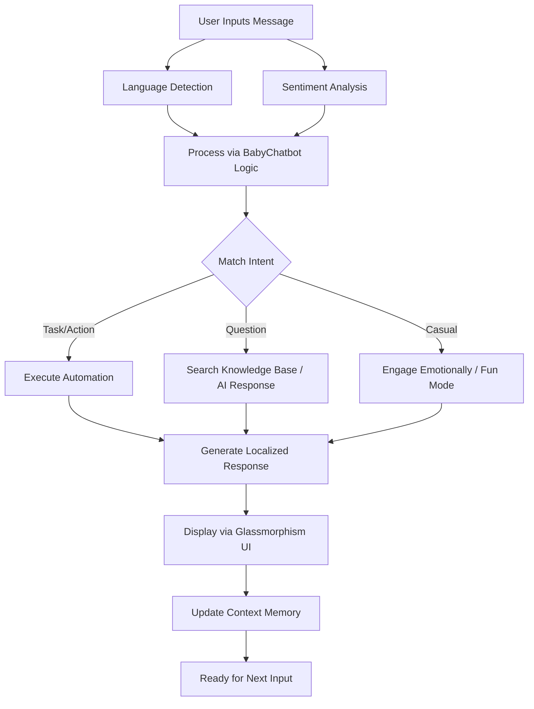

# Baby Chatbot - Advanced AI Assistant

## Project Overview
Baby Chatbot is an advanced, multilingual AI assistant designed by Sandeep. It leverages cutting-edge features including Emotional Intelligence, Contextual Memory, and dynamic Multilingual Support to provide a seamless and highly interactive user experience. Designed with a stunning, modern glassmorphism UI, this application ensures intuitive engagement whether you need task automation, learning assistance, or just a fun conversation.

### Key Features
- 🧠 **Emotional Intelligence**: Understands and responds to user sentiment dynamically.
- 🌍 **Multilingual Support**: Automatically detects and communicates in multiple languages.
- 🎯 **Task Automation**: Capable of handling scheduling, reminders, and quick actions.
- 📚 **Learning Mode**: Helps teach and explain complex topics effortlessly.
- 🎮 **Fun Mode**: Capable of jokes, interactive games, and creative discourse.
- 💭 **Context Memory**: Remembers conversational flow to maintain continuity.

## Workflow Diagram



## Setup Instructions

1. **Prerequisites**
   Ensure you have Node.js and npm installed on your system.

2. **Install Dependencies**
   Run the following command in the root directory to install the required packages:
   ```bash
   npm install
   ```

3. **Environment Setup**
   Ensure all sensitive credentials are kept secure in a `.env` file (which is safely excluded from Git). Do not commit private keys.

4. **Start Development Server**
   To spin up the Vite development server, run:
   ```bash
   npm run dev
   ```
   *The application will automatically open in your default browser at `http://localhost:5173`.*

5. **Build for Production**
   To create an optimized production build, run:
   ```bash
   npm run build
   ```
